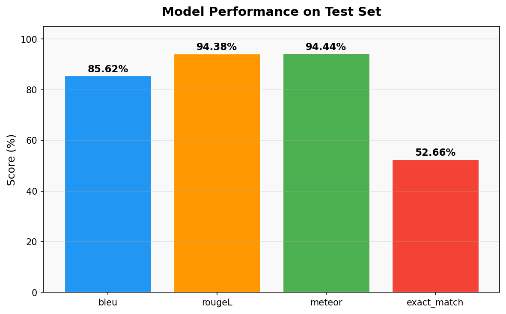
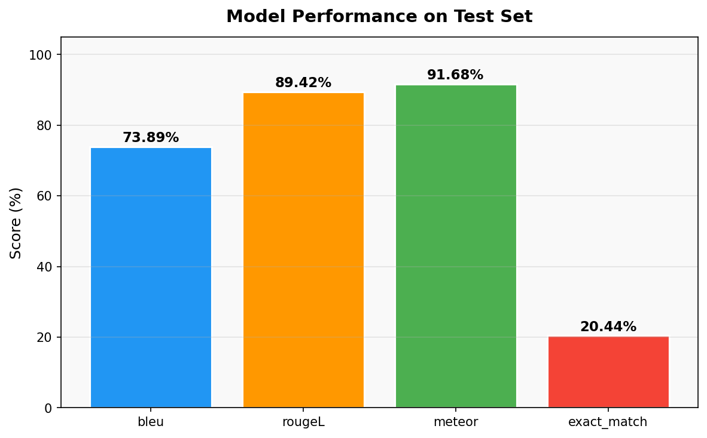
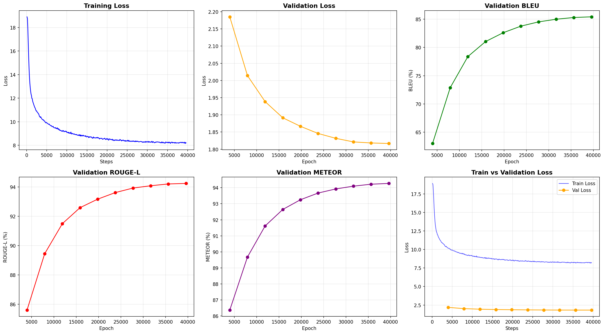
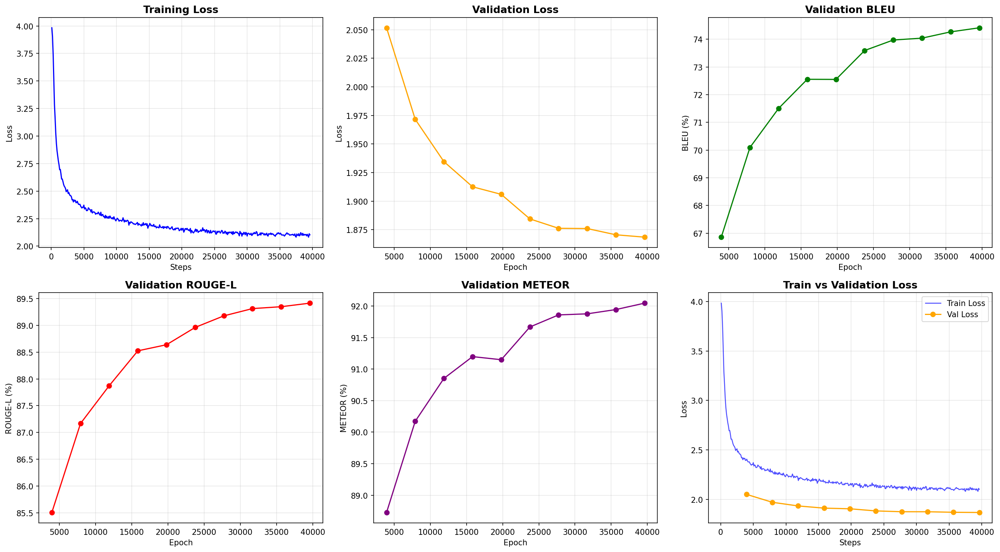
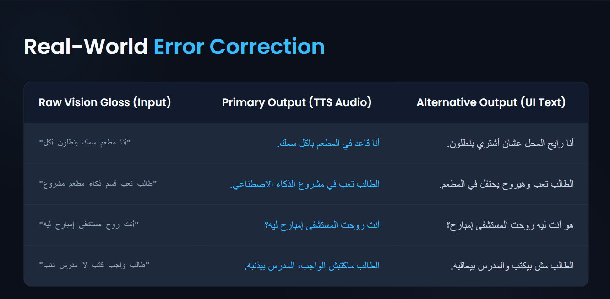

# NABRAH Sign Language Translator: NLP (English ASL and Egyptian Arabic EgySL)

The natural language processing component of a sign language translation graduation project. It translates **sign gloss into natural sentences** and **sentences back into gloss**, in two languages:

- **English ↔ ASL gloss**, using a fine-tuned FLAN-T5 model
- **Egyptian Arabic ↔ EgySL gloss**, using an engineered Gemini prompt with an EgySL grammar rule engine

## How It Works

```
Gloss    ──►  NLP layer  ──►  Natural sentence    (signer understood by a hearing person)
Sentence ──►  NLP layer  ──►  Gloss               (sentence shown as signs by an avatar)
```

Each language has its own pipeline and handles both directions, so the system covers four translation tasks: English → gloss, gloss → English, Egyptian Arabic → gloss, and gloss → Egyptian Arabic.

## English Pipeline

- **Model:** FLAN-T5-Base, chosen over Small (too weak for grammatical reordering) and Large (ran out of GPU memory)
- **Fine-tuning:** LoRA (rank 16, alpha 32, on the query and value matrices), so about 1.8M parameters (under 1%) are trained and the model's general English knowledge is preserved
- **Dataset:** 79,218 sentence pairs. I started from ASLG-PC12 and How2Sign labels, modified them to match ASL grammar rules, and added more sentences. Split 80/10/10 into 63,374 train, 7,922 validation and 7,922 test pairs
- **Training:** the validation set picks the best checkpoint (BLEU) and triggers early stopping. The final scores below come from the untouched test set
- **Augmentation:** WordNet synonym replacement on 30% of training inputs, so the model learns rules instead of memorizing sentences
- **Gloss normalizer (gloss → English):** a rule-based step before the model that moves question words from the end to the front, restructures negation, and normalizes pronouns (ME → I)
- **Inference:** beam search (5 beams) with post-processing for punctuation and capitalization

### Results (test set, 7,922 pairs)

| Direction | BLEU | ROUGE-L | METEOR | Exact Match |
|:---|:---:|:---:|:---:|:---:|
| English → Gloss | 85.62% | 94.38% | 94.44% | 52.66% |
| Gloss → English | 73.89% | 89.42% | 91.68% | 20.44% |

| English → Gloss | Gloss → English |
|:---:|:---:|
|  |  |
|  |  |

### Sample test predictions (gloss → English)

| Gloss input | Reference | Model output |
|:---|:---|:---|
| THIS WILL ENCOURAGE RATIFICATION BY THIRD COUNTRY AND CONSEQUENTLY SPEED UP ENTRY INTO FORCE THIS CONVENTION | This will encourage the ratification by third countries and consequently speed up the entry into force of this convention. | This will encourage ratification by third countries and consequently speed up the entry into force of this convention. |
| IF THIS HOUSE TAKE ITSELF SERIOUSLY IT MUST STOP THIS PRACTICE | If this house takes itself seriously , it must stop this practice. | If this house takes itself seriously, it must stop this practice. |
| COURSE IT BE GOOD COMPROMISE | Of course , it is a good compromise. | Of course, it is a good compromise. |

In the dataset the reference sentences put a space before punctuation (`seriously , it`), while the model output does not. Some outputs above therefore count as misses in Exact Match even though the wording is identical, so Exact Match understates the real quality. BLEU, ROUGE-L and METEOR are the better guide for this direction.

## Egyptian Arabic Pipeline

- **Why an API, not a local model:** most Arabic models are trained on Modern Standard Arabic, and no large parallel corpus of EgySL and Egyptian dialect exists
- **Model:** Gemini Flash-Lite, with a structured prompt and low temperature (0.1) for text → gloss and a moderate one (0.4) for gloss → text
- **EgySL rule engine:** eight ordered grammar rules (vocabulary substitution, removing function words, verb rooting, negation restructuring, SOV order, question words at the end, possessive inversion, masculine normalization), taken from an Egyptian Sign Language grammar reference
- **Closed vocabulary:** the avatar's 408-sign vocabulary is part of the prompt, so gloss output uses words the avatar can animate, and words with no match are kept instead of dropped
- **Error tolerance:** the gloss → text direction returns a primary and an alternative sentence and can ignore a sign that clashes with the context. Retry with exponential backoff handles API rate limits

### Real-world error correction

Sign recognition can misclassify a sign. The gloss → Egyptian Arabic engine detects words that clash with the rest of the sentence and returns two readings: a **primary** sentence (spoken aloud by text-to-speech) and an **alternative** sentence (shown as text on screen).

| Raw vision gloss (input) | Primary output (TTS audio) | Alternative output (UI text) |
|:---|:---|:---|
| أنا مطعم سمك بنطلون أكل | أنا قاعد في المطعم باكل سمك. | أنا رايح المحل عشان أشتري بنطلون. |
| طالب تعب قسم ذكاء مطعم مشروع | الطالب تعب في مشروع الذكاء الاصطناعي. | الطالب تعب وهيروح يحتفل في المطعم. |
| أنت روح مستشفى إمبارح ليه | أنت روحت المستشفى إمبارح ليه؟ | هو أنت ليه روحت المستشفى إمبارح؟ |
| طالب واجب كتب لا مدرس ذنب | الطالب ماكتبش الواجب، المدرس بيذنبه. | الطالب مش بيكتب والمدرس بيعاقبه. |



## Repository Structure

```
├── english/
│   ├── english_to_gloss.py     # training, evaluation, interactive demo
│   ├── gloss_to_english.py     # training, evaluation, normalizer, interactive demo
│   ├── adapter/                # trained LoRA adapter and tokenizer
│   ├── data/                   # datasets
│   └── results/                # test metrics
├── arabic/
│   ├── arabic_to_gloss.py      # Egyptian Arabic → EgySL gloss
│   └── gloss_to_arabic.py      # EgySL gloss → Egyptian Arabic
└── docs/
    ├── NLP_Documentation.md    # full technical documentation
    └── images/
```

## Tech Stack

Python, HuggingFace Transformers, PEFT (LoRA), NLTK (WordNet), Google Gemini API

## Full Documentation

[NLP pipeline documentation](docs/NLP_Documentation.md)

## Getting Started

```bash
git clone <repo-url>
cd <repo>
pip install -r requirements.txt
```

**English models.** Set the dataset path at the top of the script, then run it. It trains the model, evaluates it on the test set, saves the charts, and opens an interactive translation prompt:

```bash
python english/english_to_gloss.py
python english/gloss_to_english.py
```

**Arabic models.** Get a Gemini API key, keep it out of the code, and run:

```bash
export GEMINI_API_KEY="your-key"     # Windows: set GEMINI_API_KEY=your-key
python arabic/arabic_to_gloss.py
python arabic/gloss_to_arabic.py
```

## Limitations

- The Arabic pipeline needs an internet connection and is limited by API rate limits
- Scores come from a test split of my own dataset, so performance on sentences from other sources has not been measured yet

## Data and Credits

The English datasets are built from ASLG-PC12 and How2Sign labels, which I modified and extended. Please see the original datasets for their licenses and citation requirements.

## My Role

I designed and evaluated the NLP for English and Egyptian Arabic in both directions: English → gloss, gloss → English, Egyptian Arabic → gloss, and gloss → Egyptian Arabic. This covered the dataset, model and fine-tuning setup, the Arabic prompts and grammar rules, and the evaluation.
